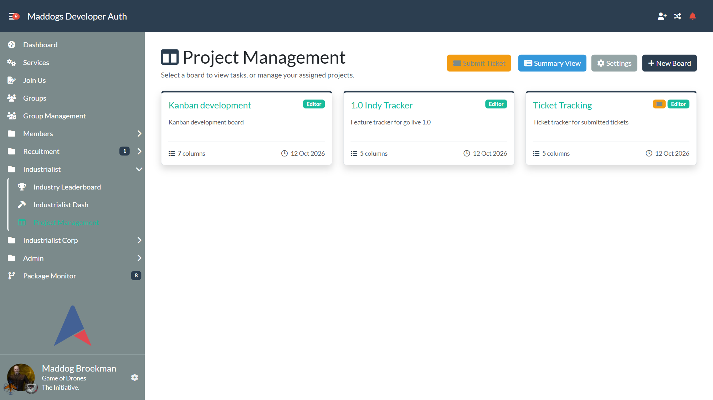
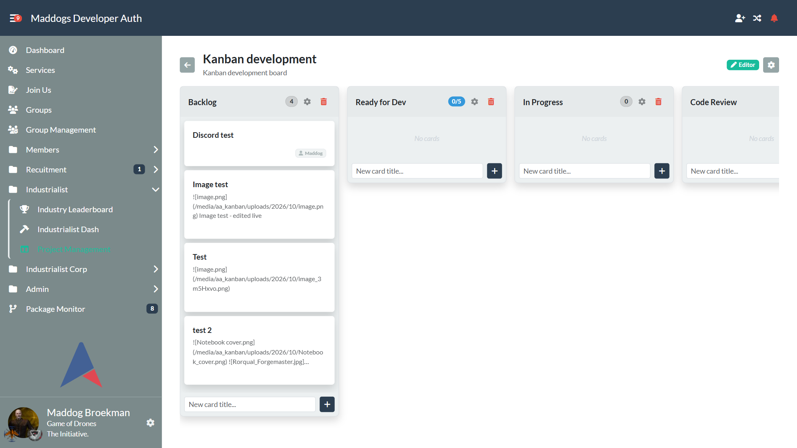
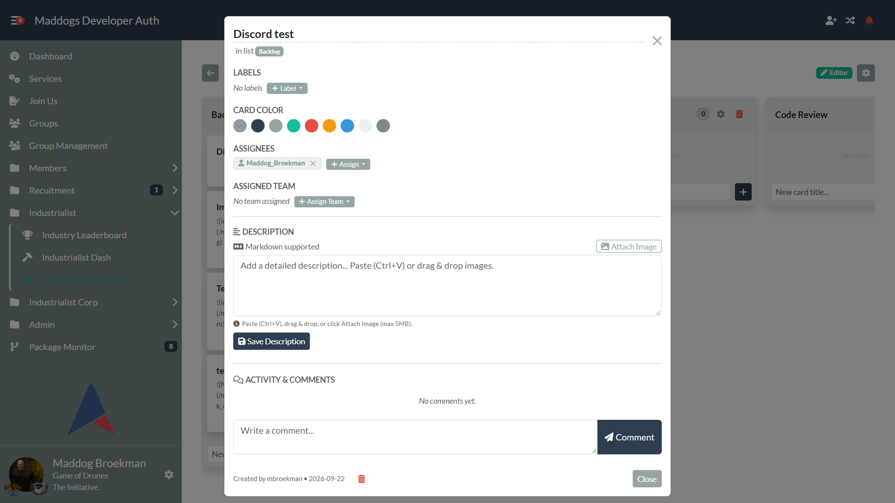
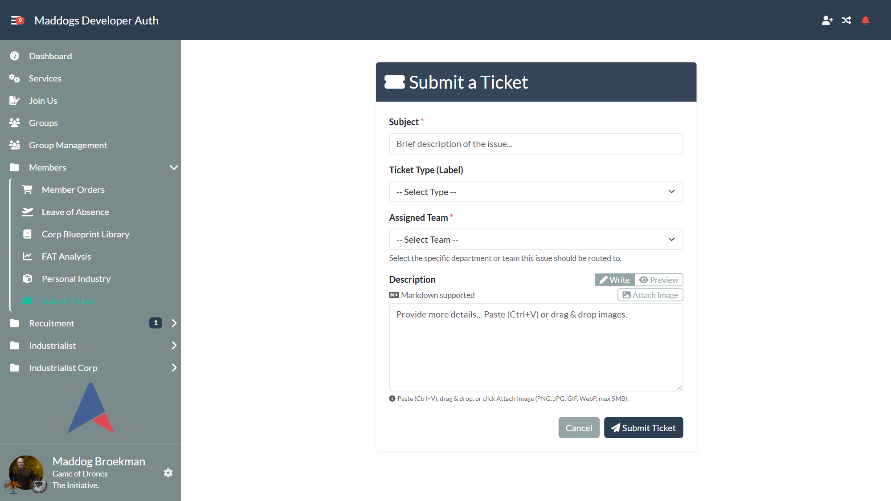
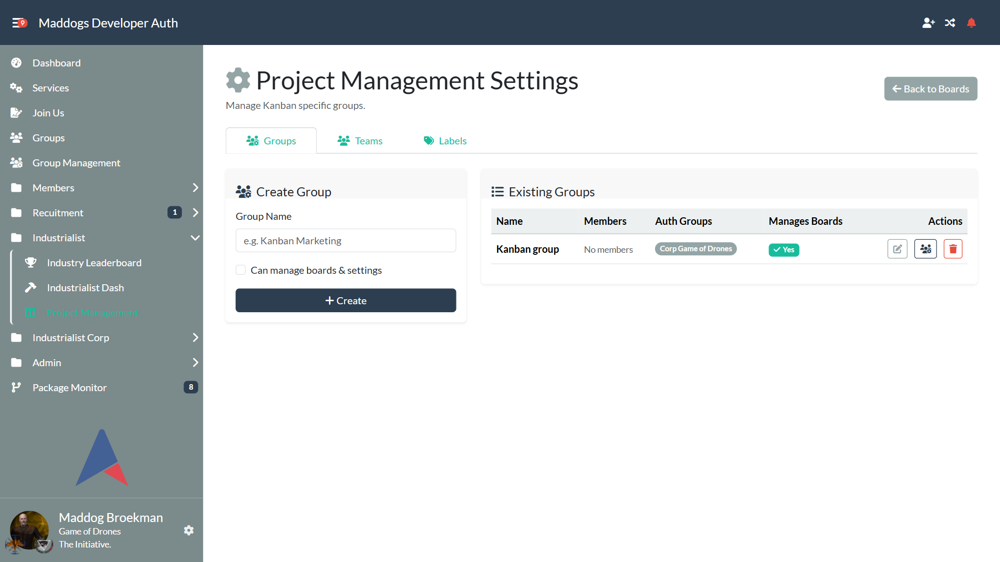
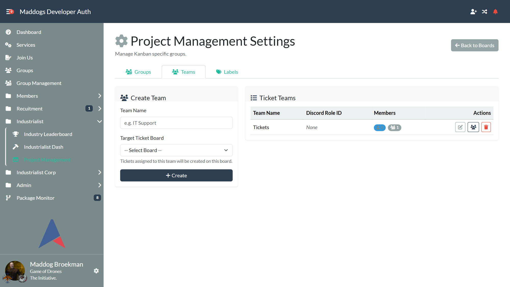
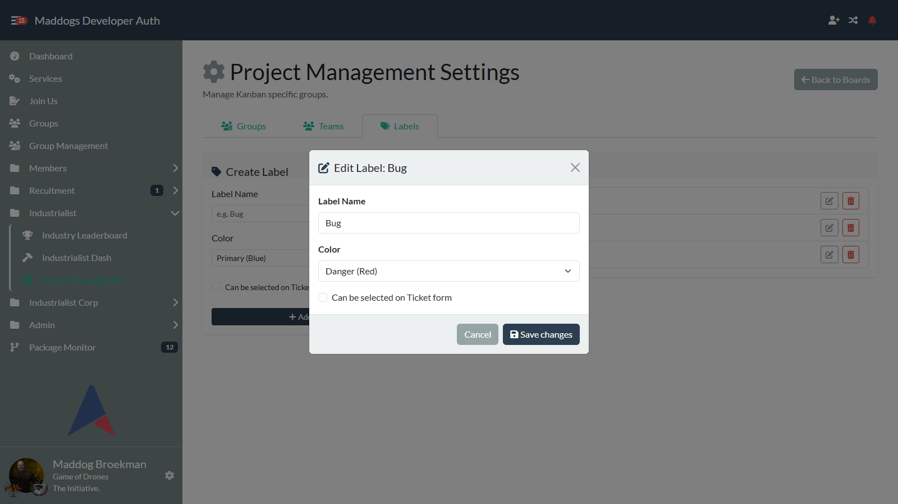

# AA Kanban - Complete User & Administration Manual

Welcome to the comprehensive user and administrator guide for **AA Kanban**, a native, fully integrated task and project management application built specifically for [Alliance Auth](https://allianceauth.readthedocs.io/).

---

## Table of Contents

1. [Overview & Architecture](#1-overview--architecture)
2. [User Roles & Permissions](#2-user-roles--permissions)
3. [Dashboard & Board Overview](#3-dashboard--board-overview)
4. [Interactive Kanban Boards](#4-interactive-kanban-boards)
5. [Card & Task Management](#5-card--task-management)
6. [Rich Markdown & Image Attachments](#6-rich-markdown--image-attachments)
7. [Ticket Submission System](#7-ticket-submission-system)
8. [Discord Bot & Thread Integration](#8-discord-bot--thread-integration)
9. [Frontend Administration & Settings](#9-frontend-administration--settings)
10. [Technical Configuration & Celery Setup](#10-technical-configuration--celery-setup)
11. [Troubleshooting & FAQ](#11-troubleshooting--faq)

---

## 1. Overview & Architecture

**AA Kanban** provides an intuitive, visual workflow engine inspired by modern Agile Kanban boards (Trello, Jira) while embedding deeply into the Alliance Auth ecosystem:

- **Native Bootstrap 5 UI**: Fully styled for Alliance Auth's default themes, including both light (Flatly) and dark (Darkly) modes with high-contrast UI elements.
- **Instant HTMX & SortableJS Interactions**: Cards and columns move effortlessly via drag-and-drop with zero full-page reloads.
- **Decoupled Frontend Administration**: All daily operational tasks (managing boards, columns, groups, teams, and labels) take place directly in the frontend user interface. No Django staff or `/admin/` access is required for officers or moderators.
- **Multilingual Support**: Complete English and Dutch localization across all views, modals, and system alerts.
- **Deep Discord Ecosystem Sync**: Built-in support for Discord threads, automatic team invitations, bidirectional comment synchronization, DM alerts, and stale card monitoring.

---

## 2. User Roles & Permissions

Access control in AA Kanban is structured into clear tiers:

| Role | Required Permission / Condition | Capabilities |
| :--- | :--- | :--- |
| **Standard User (Viewer)** | `aa_kanban.basic_access` | View boards where granted Read access; inspect cards and comments. |
| **Board Operator (Editor)** | `basic_access` + Board Write Access | Create cards, drag-and-drop tasks, edit descriptions, add labels, assign users, post comments. |
| **Ticket Submitter** | `aa_kanban.create_ticket` (or `basic_access`) | Submit requests and bug reports through the dedicated Ticket Portal. |
| **Board Manager / Admin** | `can_manage_boards=True` on user's KanbanGroup (or `aa_kanban.manage_boards`) | Create and delete boards, access `/kanban/settings/`, manage Kanban Groups, configure Ticket Teams, set global labels. |
| **Superuser / Technical Admin** | Django Superuser / Staff | Manage Django backend settings, configure Discord bot credentials, and set global webhooks. |

---

## 3. Dashboard & Board Overview

Navigating to `/kanban/` presents the **Dashboard**, the central launching point for all project boards.



### Features on the Dashboard
1. **Board Directory**: Visual cards for every board you have permission to view or manage. Each card displays:
   - Board title and descriptive summary.
   - Real-time card count and active list counter.
   - Quick "Open Board" button.
2. **Create Board Button**: Available to any user belonging to a Kanban Group with `can_manage_boards=True`.
   - Clicking **Create Board** opens a quick modal requiring a unique Board Name and optional Description.
   - Upon creation, standard industry columns are automatically initialized:
     - `Backlog`
     - `To Do`
     - `In Progress`
     - `Review/Testing`
     - `Done`
3. **Responsive Navigation Bar**: Quick links to **Dashboard**, **Submit Ticket** (for member requests), and **Settings** (for managers).

---

## 4. Interactive Kanban Boards

Clicking on any board opens the interactive workspace.



### Managing Columns (Lists)
- **Work-In-Progress (WIP) Limits**: Each column can be assigned a WIP limit. If the number of cards in a column exceeds this threshold, the counter badge clearly flags the bottleneck.
- **Drag-and-Drop Column Reordering**: Move columns horizontally across the board via drag-and-drop using either the header grab cursor or the visual grip handle (`⋮⋮`). Positions update instantaneously and persist automatically in the database.
- **Adding Columns**: Click **+ Add Column** on the right side of the board to introduce custom workflow stages (e.g., *Blocked*, *QA*, *Deployed*). Newly added columns are immediately ready for cards and can be reordered right away without leaving or refreshing the page.
- **Column Header Counters**: Dynamically display the number of cards currently residing in each column, updating instantaneously upon card movements.

### Drag & Drop Workflow
- Grab any card with your cursor (or touch device) and drag it to any list.
- Reordering within the same list updates priority ordering (`order` field).
- Moving between lists automatically updates the card status and triggers any configured webhooks or Discord thread notifications.

---

## 5. Card & Task Management

Cards represent individual work items, bugs, feature requests, or operational tasks.



### The Card Detail Modal
Clicking on any card opens the comprehensive Card Detail Modal:

1. **Title**: Click to edit the card title inline.
2. **Description with Safe Markdown**: Formatted task specifications with headings, bullet lists, code blocks, tables, and embedded images.
3. **Due Date**: Attach optional deadline timestamps to visually highlight upcoming deliverables.
4. **Color Coding**: Choose from 7 curated card accent colors (Default, Blue, Green, Red, Yellow, Purple, Dark) for visual triage.
5. **Assignees**: Assign one or more Alliance Auth pilots. Assigned users receive direct notifications.
6. **Labels**: Apply colored tags to categorize tasks across teams.
7. **Assigned Team**: Route the task to a specific department (e.g., *IT Support*, *HR*, *Logistics*).
8. **Comments & Discussion**: Post threaded discussion updates with timestamps and author details.

---

## 6. Rich Markdown & Image Attachments

AA Kanban features a powerful, secure Markdown editor and image upload pipeline.

### Supported Markdown Formatting
- **Headers**: `# H1`, `## H2`, `### H3`
- **Text Styling**: `**bold**`, `*italic*`, `~~strikethrough~~`, `` `inline code` ``
- **Lists**: Ordered (`1. `, `2. `) and Unordered (`- `, `* `)
- **Code Blocks**: Fenced code blocks with language syntax
- **Tables**: GFM table syntax (`| Column 1 | Column 2 |`)

### Uploading & Attaching Images
Images can be added to descriptions in three convenient ways:
1. **Clipboard Paste (`Ctrl+V`)**: Take a screenshot (e.g., using Windows Snipping Tool `Win+Shift+S`) and press `Ctrl+V` directly in the editor textarea.
2. **Drag & Drop**: Drag an image file from your file manager directly onto the editor dropzone box.
3. **Attach Image Button**: Click the **Attach Image** button located right above the textarea to open a file selector.

### Security & Sanitization
- **File Validation**: Uploaded files are strictly validated against maximum size (5 MB), file extension (`.png`, `.jpg`, `.jpeg`, `.gif`, `.webp`), and initial magic bytes.
- **XSS Protection**: Markdown is sanitized using BeautifulSoup against an explicit tag and attribute whitelist (`ALLOW_TAGS`, `ALLOW_ATTRS`). Dangerous protocols like `javascript:` are completely eliminated.
- **Fullscreen Lightbox**: Rendered images are automatically styled with rounded borders and responsive sizing. Clicking any image opens it in a fullscreen Lightbox modal with zoom capability.

---

## 7. Ticket Submission System

The Ticket Portal allows general alliance members to submit structured requests without needing full board editing permissions.



### How Member Tickets Work
1. Members with `create_ticket` or `basic_access` click **Submit Ticket** in the main menu (`/kanban/tickets/create/`).
2. **Form Fields**:
   - **Title**: A clear summary of the request.
   - **Assigned Team**: Select the responsible department (e.g. *Infrastructure*, *Fleet Operations*, *Recruitment*).
   - **Labels**: Tag the ticket with relevant categories.
   - **Description**: Provide full context using Markdown and image uploads, with live `[Write]` and `[Preview]` tabs.
3. **Automatic Routing**:
   - The ticket is automatically routed to the designated Ticket Board configured for the selected Team.
   - It lands directly in the board's entry column (usually *Backlog*).
   - If configured, a dedicated **Discord Thread** is instantly created.

---

## 8. Discord Bot & Thread Integration

AA Kanban features seamless integration with `aadiscordbot` and Discord webhooks:

### Automated Discord Ticket Threads
- When a ticket is submitted, the system automatically spawns a dedicated Discord Thread in the channel assigned to the destination board.
- **Automatic Team Member Invites**: All users belonging to the assigned `KanbanTeam` (including members of linked Alliance Auth groups) are automatically invited to the Discord thread.
- **Role Mentions**: If the team has a configured `discord_role_id`, the role is mentioned in the thread creation notice.

### Bidirectional Comment Synchronization
- Comments posted in the web UI are echoed to the Discord thread.
- Messages sent in the Discord thread are captured by the `KanbanTicketCog` and automatically logged as comments on the card in Alliance Auth.
- **Discord Context Menu**: Right-clicking any Discord message (`Apps -> Upload to Ticket`) allows users to push existing chat discussions straight into an active Kanban card.

### Discord Webhooks & Stale Card Alerts
- **Board Creation Webhook**: Broadcasts an announcement when a new board is launched.
- **Card Move Webhook**: Sends real-time notifications when tasks change status.
- **Stale Card Monitoring**: A periodic Celery task checks for cards that haven't been updated within a board's configured `stale_card_alert_hours`. If a card is inactive, an alert is sent to Discord, respecting the configured repeat cooldown (`stale_card_repeat_hours`).

---

## 9. Frontend Administration & Settings

All business and organizational configuration is managed through the **Settings** panel (`/kanban/settings/`).

### Tab 1: Kanban Groups & Permissions



- **Access Management**: Create Kanban Groups (e.g. *Directors*, *Fleet Commanders*, *General Membership*) and grant them **View** or **Write** access per board.
- **Auth Group Linking**: Link standard Alliance Auth groups directly to a Kanban Group so permissions synchronize automatically with member corp/alliance status.
- **Board Management Permission (`can_manage_boards`)**: Check the **"Can manage boards & settings"** checkbox to allow group members to create boards and administer settings without requiring Django staff permissions.

### Tab 2: Ticket Teams & Routing



- **Define Teams**: Establish organizational departments (e.g., *IT*, *Recruitment*, *Logistics*).
- **Target Board**: Map each team to its designated Ticket Board for automatic routing.
- **Discord Role ID**: Connect a Discord Role ID for notifications.
- **Team Membership**: Add individual users or link Auth Groups to grant team ownership and auto-invite rights.

### Tab 3: Global Labels



- **Label Creation & Editing**: Create and edit shared tags used across all boards. Click the Edit button on any label to modify its name, color, and ticket form availability in the Edit Label modal.
- **Color Palette**: Choose distinct, accessible colors with high contrast for both light and dark themes.

---

## 10. Technical Configuration & Celery Setup

### Django Settings (`local.py`)
Ensure `aa_kanban` is included in your `INSTALLED_APPS` and media settings are configured:

```python
INSTALLED_APPS += [
    "aa_kanban",
]

# Media settings for image attachments
MEDIA_ROOT = "/home/allianceserver/myauth/media/"
MEDIA_URL = "/media/"
```

### Celery Beat Schedule
To enable automated stale card alerting, add the periodic task to `CELERYBEAT_SCHEDULE`:

```python
CELERYBEAT_SCHEDULE["aa_kanban.check_stale_cards"] = {
    "task": "aa_kanban.tasks.check_stale_cards",
    "schedule": crontab(minute=0),  # Runs hourly
}
```

### Static Files Collection
When deploying updates to CSS or JavaScript assets:

```bash
python manage.py collectstatic --noinput
```

---

## 11. Troubleshooting & FAQ

### Q: Why do inactive buttons appear dark or hard to read?
**A**: Alliance Auth uses Bootswatch themes. In Darkly, button outlines require explicit theme overrides. AA Kanban includes comprehensive CSS rules targeting both `html[data-theme="darkly"]` and `[data-bs-theme="dark"]`. If buttons look unstyled, ensure you ran `collectstatic`.

### Q: Why did an image upload fail?
**A**: Verify that the file size is below 5 MB and that the image format is PNG, JPEG, GIF, or WebP. Corrupted files failing magic bytes inspection will be rejected automatically for security.

### Q: Are member tickets visible to all users?
**A**: No. Tickets are placed on the configured board for the assigned team. Only users belonging to Kanban Groups with View or Write access to that specific board can inspect and manage the resulting cards.

---

*Manual maintained for AA Kanban v0.13.0+.*
